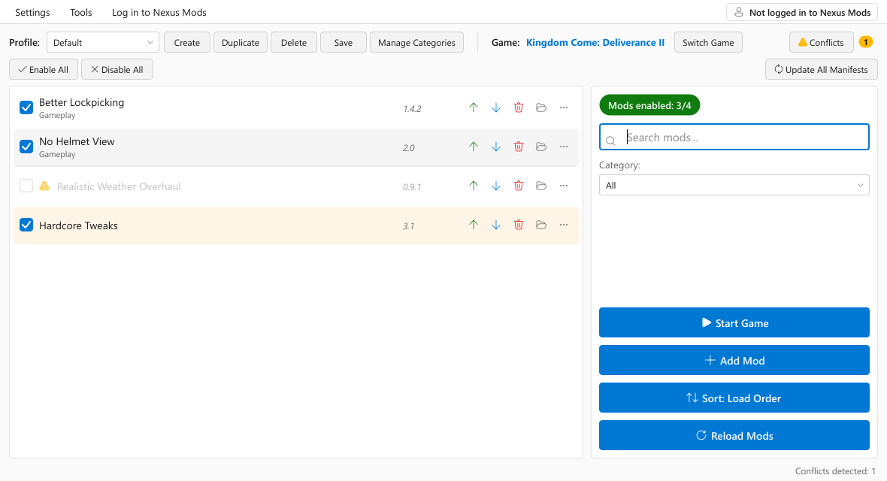
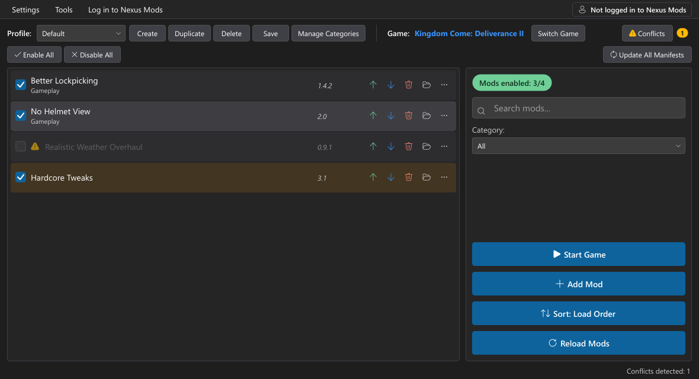
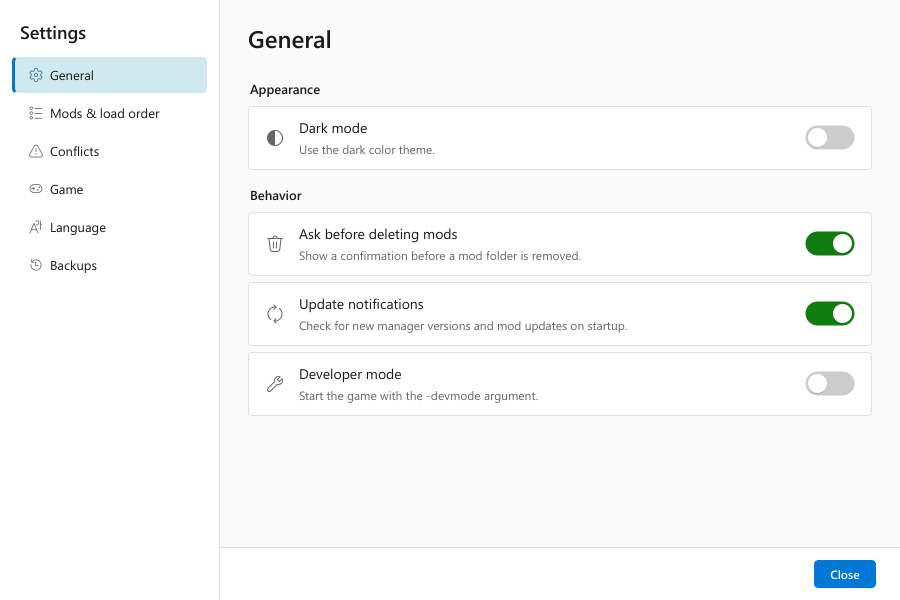

# KCD Mod Manager (Python edition)

A cross-platform mod manager for **Kingdom Come: Deliverance** and **Kingdom Come: Deliverance II**,
for Windows and Linux (Steam/Proton). It is an independent rewrite of the WPF/C# KCD Mod Manager
in Python + PySide6 and works with the same data (profiles, categories, notes, load order).



| Dark theme | Settings |
| --- | --- |
|  |  |

## Features

- Detects both games (Steam libraries, GOG, common install paths, or a manually chosen
  `KingdomCome.exe`); Linux Steam (native, Flatpak, Snap) and Proton installs are supported.
- Install mods from `.zip`, `.7z` and `.rar` archives or folders (button or drag & drop). Folder
  structures are preserved, and installs are staged so a failed install never destroys the old copy.
- Enable/disable, drag & drop load order, move to top/bottom/position, separators, highlight colours.
- Profiles per game (create, duplicate, delete, save; the last used profile is remembered).
- Categories (manage, assign, filter, sort by category), search, sort by load order/title/category.
- Conflict detector (scans `.pak` contents, with cancel and an "ignore this mod" option).
- Nexus Mods: SSO login, update checks, premium one-click updates, endorse, open mod page.
- Steam Workshop mods are listed and can be ordered, but their files are never modified.
- Mods backups (on startup or on demand, with automatic pruning), and a game manifest `gameVersion` updater.
- Light/dark theme; English, German and French.

## Install

Release builds are produced by GitHub Actions (`.github/workflows/release.yml`):

| Platform | Artifact |
| --- | --- |
| Windows | `KCDModManager-<ver>-windows-x64-setup.exe` (per-user installer, no admin needed) |
| Windows | `KCDModManager-<ver>-windows-x64-portable.zip` (extract and run `KCDModManager.exe`) |
| Linux | `KCDModManager-<ver>-x86_64.AppImage` (`chmod +x`, then run) |
| Linux | `KCDModManager-<ver>-linux-x86_64.tar.gz` (run `KCDModManager`; `install-desktop-entry.sh` adds a menu entry) |

Coming from the WPF version? Read [docs/MIGRATION.md](docs/MIGRATION.md). Your data is picked up
automatically; nothing is moved or deleted.

## Run from source

Requires [uv](https://docs.astral.sh/uv/). It installs Python 3.13 and all dependencies.

```bash
uv sync
uv run kcd-mod-manager            # or: uv run python -m kcd_mod_manager
uv run kcd-mod-manager --offline  # skip Nexus/update checks at startup
uv run kcd-mod-manager --data-dir /tmp/kcdmm-test   # use a separate data folder
```

`KCDMM_DATA_DIR` also overrides the data folder. Use it when experimenting so your real profiles stay untouched.

## Develop

```bash
uv sync --group dev
uv run ruff format --check src tests scripts
uv run ruff check src tests scripts
uv run pyright
uv run pytest -q                  # headless (QT_QPA_PLATFORM=offscreen), temp dirs only
uv run python scripts/smoke_screenshot.py out/   # renders the UI against a fake game
```

Tests never touch real user data or a real game installation. `tests/conftest.py` redirects
`KCDMM_DATA_DIR`, `APPDATA`, `LOCALAPPDATA` and `XDG_CONFIG_HOME` to temporary folders.

## Build

```bash
uv sync --group build
uv run python scripts/build.py --installer   # Windows: portable ZIP + Inno Setup installer
uv run python scripts/build.py --appimage    # Linux: tarball + AppImage (needs appimagetool)
```

Artifacts go to `release/` together with a `SHA256SUMS-*.txt`. The script runs the frozen
executable with `--self-test` and stops if Qt, resources, translations or archive backends fail to load.

Packaging choices:

- **PyInstaller one-folder build.** It starts faster than one-file builds, avoids temporary
  extraction (which antivirus tools dislike) and serves as the base for every package.
- **Windows installer: Inno Setup** rather than WiX. A single readable script, per-user installs
  without admin rights, built-in German/French setup languages, and Inno is preinstalled or
  installable via Chocolatey on GitHub runners. WiX would need MSI component authoring and file
  harvesting for thousands of Qt files, with no benefit for a desktop tool that is not deployed via GPO.
- **Linux: AppImage + tarball.** The AppImage is a single file that runs on most distributions; the
  tarball is the fallback for systems without FUSE. Flatpak was rejected: its sandbox needs broad
  filesystem permissions for Steam libraries and game folders, and launching Steam or `xdg-open`
  from inside the sandbox needs `flatpak-spawn`, which works against what a mod manager does. The
  Linux build runs on Ubuntu 22.04 so the glibc requirement stays low.

### Publishing to Nexus Mods

To release:

1. Bump `__version__` in `src/kcd_mod_manager/__init__.py` and `version` in `pyproject.toml`.
2. Move the `## [Unreleased]` notes in `CHANGELOG.md` under a new `## [X.Y.Z]` heading.
3. Commit, then push the tag: `git tag vX.Y.Z && git push origin vX.Y.Z`.

The release workflow first checks that the tag matches `__version__` and that `CHANGELOG.md` has a
non-empty section for it; otherwise nothing is built or published. It then builds both platforms,
creates the GitHub release with that section as release notes, and uploads three files to each of
the KCD1 and KCD2 mod pages with the official
[Nexus-Mods/upload-action](https://github.com/Nexus-Mods/upload-action):

| Nexus file | Uploaded archive |
| --- | --- |
| Portable | `KCDModManager-X.Y.Z-windows-x64-portable.zip` |
| Installer | the setup `.exe`, zipped |
| Linux | AppImage and tarball, zipped together |

Every upload archives the previous version of that file. The portable upload also adds the
changelog section (as plain text) to the mod page and sets the page's version. Tags containing `-`
(such as `v5.1.0-rc1`) are released on GitHub only.

One-time setup in the GitHub repository settings (Secrets and variables, then Actions). All IDs
are the numbers shown on the website: the mod ID from the page URL and the file ID from the Files
tab. `scripts/nexus_release.py` translates them to the internal v3 IDs the upload endpoints expect.

| Kind | Name | Value |
| --- | --- | --- |
| Secret | `NEXUSMODS_API_KEY` | API key from <https://www.nexusmods.com/settings/api-keys> |
| Variable | `NEXUSMODS_MOD_ID_KCD1`, `NEXUSMODS_MOD_ID_KCD2` | mod ID of each page |
| Variable | `NEXUSMODS_FILE_ID_KCD1_PORTABLE`, `NEXUSMODS_FILE_ID_KCD2_PORTABLE` | portable file |
| Variable | `NEXUSMODS_FILE_ID_KCD1_INSTALLER`, `NEXUSMODS_FILE_ID_KCD2_INSTALLER` | installer file |
| Variable | `NEXUSMODS_FILE_ID_KCD1_LINUX`, `NEXUSMODS_FILE_ID_KCD2_LINUX` | Linux file |

While a Linux file ID is unset, the release creates a new Linux file on that page (documented
`POST /mod-files` endpoint) and prints its ID in the run summary; set the variable to that ID so
later releases add versions to it instead of creating another file. A missing portable or
installer file ID skips that upload with a warning. The key is only read from the secret and is
never written to logs or artifacts.

## Project layout

See [docs/ARCHITECTURE.md](docs/ARCHITECTURE.md).

## License

GPL-3.0-only, the same as the original project. See [LICENSE](LICENSE).

The interface icons are from Microsoft's
[Fluent UI System Icons](https://github.com/microsoft/fluentui-system-icons) (MIT, see
[`src/kcd_mod_manager/resources/icons/LICENSE`](src/kcd_mod_manager/resources/icons/LICENSE)).
